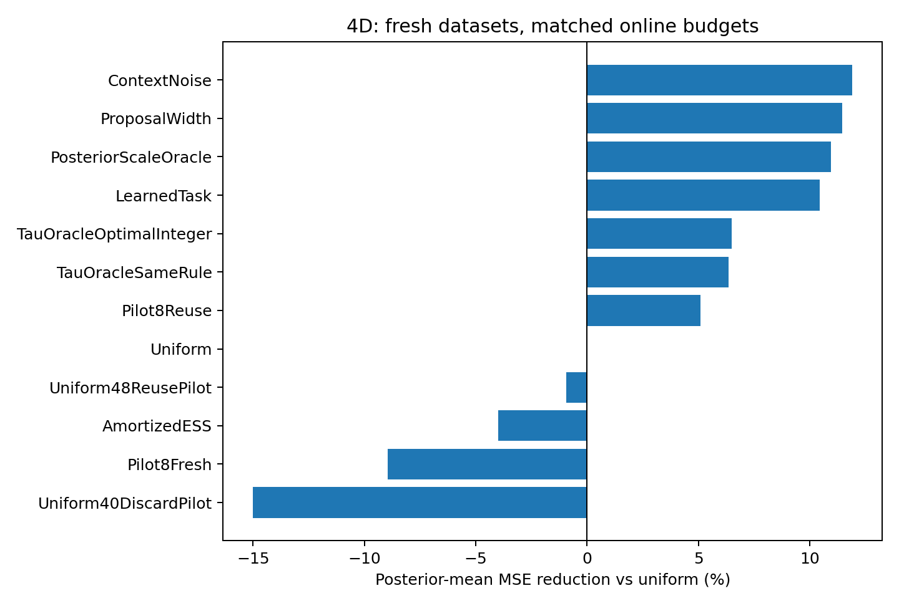
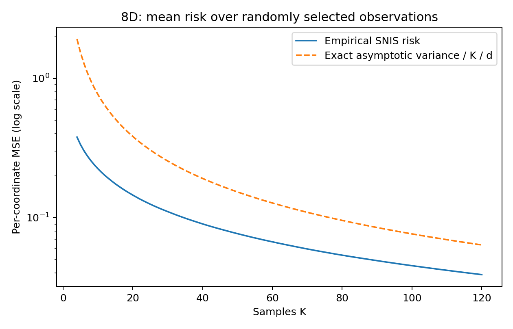

# Task-Aware Amortized Importance Sampling

This study investigates how to distribute a fixed importance-sampling budget across observations to reduce posterior-mean estimation error. The initial method learns observation-specific self-normalized importance sampling (SNIS) asymptotic variance offline. Subsequent experiments test simpler allocation rules, proposal quality, posterior reference reliability, and the finite-sample accuracy of the asymptotic objective.

## Experiments

| Stage | Notebook | Results |
| --- | --- | --- |
| 1. Initial importance sampling | [Notebook](notebooks/01_initial_importance_sampling.ipynb) | [Monte Carlo convergence, evidence, moments, training, nonlinear stress tests and IWAE gradient SNR](results/01_initial_study/) |
| 2. Amortized task-aware allocation | [Notebook](notebooks/02_phase2_task_aware_amortized.ipynb) | [Synthetic and VAE pilots, budget curves, paired comparisons](results/02_phase2_teacher512/) |
| 3. Independent confirmation | [VAE notebook](notebooks/03_vae_confirmation.ipynb) | [Synthetic confirmation: 512, 1024 and 2048 teacher draws](results/03_synthetic_confirmation/) |
| 4. Proposal-quality follow-up | [Notebook](notebooks/04_vae_proposal_followup_executed.ipynb) | [VAE validation, MSE, references and figures](results/04_vae_followup/) |
| 5. Reference convergence | [Notebook](notebooks/05_reference_convergence.ipynb) | [Reference sample-size study](results/05_reference_convergence/) |
| 6. Independent posterior checks | [Notebook](notebooks/06_independent_reference_checks.ipynb) | [Weight outlier and HMC diagnostics](results/06_independent_reference_checks/) |
| 7. Direct HMC comparison | [Notebook](notebooks/07_direct_hmc_comparison.ipynb) | [Coverage and paired comparisons](results/07_direct_hmc_comparison/) |
| 8. Oracle headroom and finite-sample risk | [Notebook](notebooks/08_synthetic_oracle_finite_sample_risk.ipynb) | [Baselines, oracle headroom, risk calibration and figures](results/08_synthetic_oracle_risk/) |

## Mathematical objective

For observation i, the asymptotic SNIS posterior-mean risk is proportional to tau_i^2 / K_i, where tau_i^2 = E_q[(p/q)^2 ||z - mu_i||^2]. Minimizing its sum subject to a fixed total budget B gives the unconstrained continuous solution K_i = B tau_i / sum_j tau_j. The finite-sample risk need not follow that curve. The code compares the learned allocator with uniform allocation, ESS-based allocation, context noise, proposal width, eight-draw pilot methods, and exact asymptotic oracles.

## Findings

On 25 fresh datasets per dimension, the original learned allocator reduced posterior-mean MSE relative to uniform by 10.45% (4D) and 8.88% (8D). Context-noise allocation achieved 11.90% and 10.25%, respectively; proposal width also outperformed the learned method. The exact asymptotic oracle reduced measured finite-sample MSE by 6.50% and 5.48%; it is not the oracle for finite-sample risk.

At K=48, empirical/asymptotic risk ratios were 0.577 and 0.497. The asymptotic variance retained useful ranking information but was poorly calibrated at the tested sample counts.

The independent HMC comparison on eight 8D VAE seeds found a 0.495% point estimate of relative MSE improvement, with paired 95% CI for the MSE difference [-0.004387, 0.003168]. This does not establish a reliable VAE improvement. The cheap synthetic heuristics outperform the learned allocator in this setting. Learning finite-sample risk and reliability-aware allocation remain proposed extensions, not completed results.

## Reproduction

Open the relevant notebook in Google Colab, run the setup cells, and use smoke mode first where available. Synthetic runs can use a CPU; a GPU is useful for VAE experiments. Follow the saved configurations and notebook Drive/output path settings. Diagnostic add-ons in [scripts](scripts/) expect the corresponding setup and checkpoints. Some large per-seed model checkpoints and intermediate files are not committed here; those are retained in the separately prepared research archive. Use only trusted serialized models.

The [updated research proposal (LaTeX)](docs/Task_Aware_Amortized_Importance_Sampling_Updated.tex) distinguishes completed experiments from proposed research. The experimental configuration metadata records the actual 2026 runs. The results include negative and inconclusive findings as well as favorable ones.
